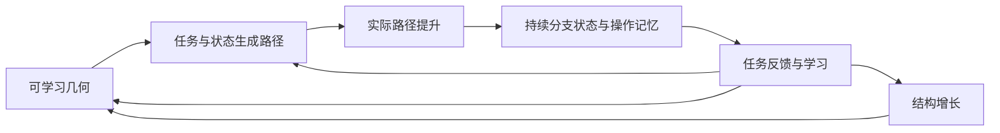

# Monodromy — 一个持续生长的计算空间

**设计准则：让几何、执行、记忆与学习属于同一套语言。核心的简洁、优美和贯彻度优先；数学陈述与测量始终如实。**

这是 Phase 0 的架构候选。**Lean 是唯一原生研究环境：定义、构造、算法与证明从 [Monodromy.lean](../Monodromy.lean) 开始生长；本文负责解释设计方向。**形式化范围和历史证据见 [NOW.md](../NOW.md)。[MATHEMATICS.md](mathematics.md) 保留迁移前解析草稿，尚未整体通过 Lean；下文未链接到已检查声明的机制仍是待构造候选。当前没有新增训练或数值执行结果；量子载体方向见文末。

## 一条闭环

最小状态为 `S=(θ,u,z,𝓟,𝓗;ψ)`：`θ` 定义几何，`u` 是控制，`z` 是持续携带的分支，`𝓟` 保存可执行路径，`𝓗` 保存有界的经验和来源。提案器 `ψ` 包含路径和几何编辑参数块，后者下记 `η`；全部参数及优化状态随 checkpoint 保存。初始化、数值状态、随机数和预算另随执行记录保存。

**计算与分支写入使用同一个动作：沿路径提升当前状态。** 回路结束时控制可以回家，计算状态留在新的分支上；后续计算从这个实际状态继续。

## 1. Learned Computational Geometry

从联合覆盖的第一性原理出发，多项式提供一个明确的可学习载体候选：

\[
F_\theta(z,u)=p_\theta(z)-u=0,\qquad
p_\theta(z)=z^5+a_3z^3+a_2z^2+a_1z.
\]

三个复系数共六个实参数。初值 `(a₃,a₂,a₁)=(0,0,−5)`，基点 `u₀=0`；初始纤维为 `0` 和 `z⁴=5` 的四个根。临界根为 `±1,±i`，临界控制值为 `±4,±4i`。

固定次数、单首且排除判别集时，这给出五叶有限覆盖。类内适应还要求基点正则、临界根简单、临界值互异，以及旧登记路径的完整安全条件。该多项式语法由设计者提供；学习的是系数和后续结构选择，不能称为无先验地发明覆盖。

在临界根 `rⱼ` 上，有

\[
dc_j=r_j^3\,da_3+r_j^2\,da_2+r_j\,da_1.
\]

系数因此能改变分支临界值的相对布局。以后在控制坐标中提出的路径，可以获得不同的类别概率、净空与执行代价。旧库只保护已经获得的操作，给未获得的操作留下几何自由。

在简单且互异的临界值区域内，整个作用群仍为 `S₅`。几何适应可以改变获取条件；新增已掌握操作与扩大整个作用群分别记录。

## 2. Learned Path Construction

同一个提案器从任务可用信息、当前状态、经验和几何中，选择复用路径或提出新路径。例如

\[
(L,v)\sim\pi_\psi(\cdot\mid x,g,z,\mathcal P,\mathcal H,\theta),\qquad
v_j=(x_j,y_j)\in\mathbb R^2,\quad
w_j=R(\tanh x_j+i\tanh y_j),\quad
\gamma=(u_0,w_1,\ldots,w_L,u_0).
\]

长度、调用和结构编辑是明确的离散选择；顶点定义实际连续折线，实部和虚部各在 `(-R,R)` 内。学习者通过终端任务反馈评价结果，路径生成接口不接收正确置换或正确回路。

**原语与程序分型：**一个 monodromy 原语在其全部输入 sheets 上使用同一条 based loop；这条回路可以位于固定几何的控制空间，也可以位于联合空间 `(θ,u)`。根据当前分支选择不同回路的对象称为带条件的程序，其整体可以非双射。两者都可以进入架构，分别声明合同。开放路径则作用于不同纤维，按 groupoid 组合。

## 3. Executable Topological Computation

更基本的空间是正则联合基空间 `𝓑={(θ,u):Disc_z Fθ≠0}`。计算控制与几何改变都是其中的路径 `β=(θ,u)`；唯一的连续执行规则是约束提升：

\[
\dot z=-\frac{F_u\dot u+F_\theta\dot\theta+\kappa F}{F_z}.
\]

对上面的五次关系，它展开为

\[
\dot z=
\frac{\dot u-z^3\dot a_3-z^2\dot a_2-z\dot a_1-\kappa F}
     {5z^4+3a_3z^2+2a_2z+a_1}.
\]

`κF` 是局部残差校正。实际算法从当前 `z` 预测并局部校正，检查净空、残差、步长和工作上限。初始化可以付费求根；连续执行和恢复从实际保存的状态续行。失败后的恢复、逆路径或回滚都有状态语义和成本。

控制原语固定 `θ`；参数原语则保存并执行完整的 `(θ,u)` 回路，返回共同联合基点。参数回归并不保证内部状态回归：[四叶解析见证](mathematics.md) 在保留旧操作的同时，通过闭参数路径实现另一项作用。

先 a 后 b，约定 `Tₐ→ᵦ=Tᵦ∘Tₐ`。复合由路径串接执行；精确约束上的理想提升中，反向联合路径提供逆操作。残差衰减和数值校正的恢复误差另行检查。非交换性由携带同一状态执行 `a→b` 和 `b→a` 检验。

## 4. Persistent Memory & Learning

**状态记忆就是当前分支。**首版在基点通过已输运的 anchors 读取分支，开放路径保留局部状态及其输运记录；写入为 `z′=Liftθ(z,γ)`。后续操作使用真实的 `z′`。可学习读出作为独立接口声明其信用与保持合同。增加记忆单元时，每个单元都保存自己的分支与控制，寻址、准备及共享几何改变时的输运全部计价。

**操作记忆就是曾经获得的路径。**每条记录保存路径配方、基点和方向、调用条件、几何版本、实际执行轨迹、任务准入依据、作用观测及成本。作用表可以用于审计和规划；连续执行模式中的调用继续做真实提升。缓存执行另标模式。

候选根据合法反馈获得用途，经作用与绑定检查后入库，再在新上下文中调用。测量完整纤维作用需要额外分支准备与执行；这些是自生成的知识，不免费提供给学习者。

多对一写入由状态依赖的程序实现时，要记录信息丢失及准备成本；若要求整个过程可逆，则保存足够的选择记录或辅助状态，并对清理计价。第一版的持久核心保持为分支和路径库，连续 payload、键值库等扩展另有明确任务角色时再加入。

## 5. Geometric Adaptation

几何与路径共同学习。新路径的任务回报更新提案器；过去任务块的获取经历评价下一次几何编辑。

\[
G=r_{\rm task}-\lambda_W W-\lambda_Q Q-\lambda_I I,\qquad
\widehat{\nabla_\psi J}=(G-b)\sum_t\nabla_\psi\log\pi_\psi(a_t\mid S_t).
\]

明确的随机路径提案为类别变化提供信用；连续执行敏感度可以优化条件数或连续读出。两条通路各司其职，不把精确 sheet 类别的局部常值导数当作新操作梯度。

对几何编辑，先从过去经验条件化的分布 `qη` 采样有界 `Δθ`，再检查安全性。接受则安装新几何，拒绝则保留原几何；两者照常执行同一下一任务块，并计入各自检查成本。块内冻结几何，延迟记录

\[
C=C_{\rm edit}+C_{\rm protect}
 +\sum_j C_B(\operatorname{Acquire}(\tau_j;\theta',\psi_0,\mathcal P_0))
 +\lambda_R C_{\rm retention},\qquad
\widehat{\nabla_\eta\mathbb E C}=(C-b)\nabla_\eta\log q_\eta(\Delta\theta\mid\mathcal H).
\]

这里使用的是训练任务流的延迟反馈；独立评估任务在几何和学习规则冻结后揭示。拒绝与超时也计入回报，不能只对筛选后的接受样本套用无校正的 score-function 公式；基线 `b` 只依赖提案前信息。两个式子分别固定执行环境及内层初始化，给出路径提案和几何编辑的信用；若共享参数或加入可学习读出，须补齐对应梯度通路。完整比较分叉的成本也入账。

**旧操作保护：**在基点处连续输运现存分支和 anchors，以同一 `τ` 比较新旧作用。五次关系有一个保守充分条件：旧路径全部根的间隔至少 `δ`，取 `0<r<δ/2`，圆盘上 `|z|≤R`，旧路径位移至多 `ν`，且

\[
|\Delta a_3|R^3+|\Delta a_2|R^2+|\Delta a_1|R+\nu
 <r(\delta-r)^4.
\]

Rouché 定理保证整个直线系数/路径同伦在各根管内保持单根，从而在共同输运下保持旧作用。`δ,R` 必须有完整路径的认证依据；采样最小值只作诊断。另行检查旧编码、调用、寻址和读出关系，才得到完整旧任务保持。几何迁移还须声明用途：保持读出约定时它可以写入状态；同步输运编码/读出时它可以承担语义保持的表示改变。

## 6. Structural Growth

对线性依赖 `u` 的多项式载体，采用保持语法的增长：写 `F=Aθ(z)−uBθ(z)`，其中 `A` 单首、`deg A=D`、`deg B≤D−1`；初始 `A=pθ,B=1`。任务中的表示冲突或持续获取困难促使结构提案器选择 `(r,ε)`：

\[
F^+(z,u)=(z-r)F(z,u)-\epsilon.
\]

这仍是同一形式：`A⁺=(z−r)A−ε`，`B⁺=(z−r)B`，次数增加一。先分配与旧根管分离的常值 sheet，再沿耦合路径迁移实际状态。若旧根管边界上统一满足 `|ε|<|(z−r)F|`，Rouché 条件保护旧根与旧操作。

新的分支连接提供待探索路径；实际提升与任务反馈决定其用途。新操作准入后加入记忆和保护集，新的系数参与后续几何学习。增长是离散结构事务，不能归入固定覆盖类型的安全变形。`r`、耦合量、候选路径及验证工作都显式记录。[三叶到四叶解析草稿](mathematics.md) 提议整个 `0≤ε≤10⁻⁶` 区间的旧操作保护及新连接论证，尚待 Lean 验证。

## 一个贯通五环的解析例子

为便于人完整理解，先在同类关系的三次实例中检查机制：

\[
F_a=z^3-3a^2z-u,\quad a\in[.9,1],\quad
u_0=0,\quad(z_0,z_1,z_2)=(-\sqrt3a,0,\sqrt3a).
\]

旧路径从 0 到 −.75，逆时针绕中心 −1.5、半径 .75 的圆，再返回。临界值为 `±2a³`；全区间圆周净空至少 .25，旧作用 `A=(12)` 保留。用过去路径的执行统计优化 `Lold=(2a³−1.5)²`，其解析最小点 `a*=(3/4)^(1/3)` 把旧圆周净空提高至 .75。

以后提案固定为中心 `c∼U[1.1,1.7]`、半径 .2 的逆时针圆，往返柄明确为折线 `h=(0,.5i,c+.5i,c+.2i)`；从圆顶点出发绕行，再沿 `h⁻¹` 返回。柄距实轴临界值至少 .2，整条路径要求临界值净空至少 .05。在 `a=1` 时所有候选作用为 I。在 `a=a*` 时，`c∈[1.35,1.65]` 安全产生 `B=(01)`：未条件化发现概率为 `1/2`，有效候选概率为 `3/4`，有效候选中 B 占 `2/3`。无效提案也收费。

旧库 `<A>` 固定 sheet0；新 B 可以使它转移至 sheet1。获得该终端反馈后，学习者把实际成功路径记入库，之后从当前分支调用和组合。上述 A/B 标签只用于解析说明与评估，学习接口不接收它们。查询恢复使用实际逆路径并检查恢复误差。

**这是手工构造的解析机制见证，尚未运行学习器。**它让“过去执行经验→安全几何变化→未来路径类别概率→新操作与记忆”成为具体对象。缩放 `z=aζ,u=a³v` 也给出精确普通对照；这个匹配界定其科学结论，同时保留完整构造的价值。五次候选继续研究非仿射布局，并保留同等有力的普通路径适应对照。

## Phase 0：先让这件作品成立

1. **构造成立：**同一约束关系贯穿路径、状态、记忆、适应与增长。五环都有真实接口，逐项说明设计自由度；本文件给出首版。
2. **数学成立：**在 Lean 中直接发展覆盖、输运、保护与增长。[MATHEMATICS.md](mathematics.md) 的联合多项式覆盖、参数矩形、四叶解析实例、发现概率及增长嵌入仍需构造；通用定理与离散见证不能替代具体载体证明。随后补齐数值合同与学习性质。
3. **执行成立：**后续实现围绕一个 `lift` 内核展开。关键测试覆盖解析平方根/三次例、反向路径与复合、参数迁移、安全及不安全变形、连续状态恢复、一次受保护增长。测试验证数学性质及真实故障。
4. **学习闭环成立：**从反馈获得操作、记为路径、在后续任务复用；过去经验确实更新几何，并影响尚未提出的计算。给出一个从初始化到增长的可追踪执行故事。
5. **科学与工程评价：**在作品成立的基础上比较冻结/随机几何、普通提案适应、预条件及程序/FSM 对照。如实分别报告因果作用、学习收益与完整成本。普通方法匹配或短期较慢时，保留核心，定位具体原因并从同一数学语言发展下一版。

上述执行与学习项尚待实施；此前暂不启动训练、实验和实现重写的限制继续生效。工作状态与下一步见 [NOW.md](../NOW.md)。

## 通向 Quantum Monodromy

长期量子载体沿用“路径→输运→操作→记忆→几何学习”的接口。下一项数学合同是明确的有隙简并态丛、其连接、实际有限时间演化，以及何时 holonomy 因子化为基本群的幺正表示。经典置换可嵌入幺正作用，但这个嵌入本身不提供物理实现、相位保护或量子学习优势。

量子版本还须让相干存储、读写、Born 反馈、控制与校准属于同一执行故事。当前复根原型提供可检查的构造语言；态丛、Hamiltonian、相位/误差与测量合同尚待构造。量子实现与经典模拟分别标明，保持同样简洁的核心与如实的证据。
